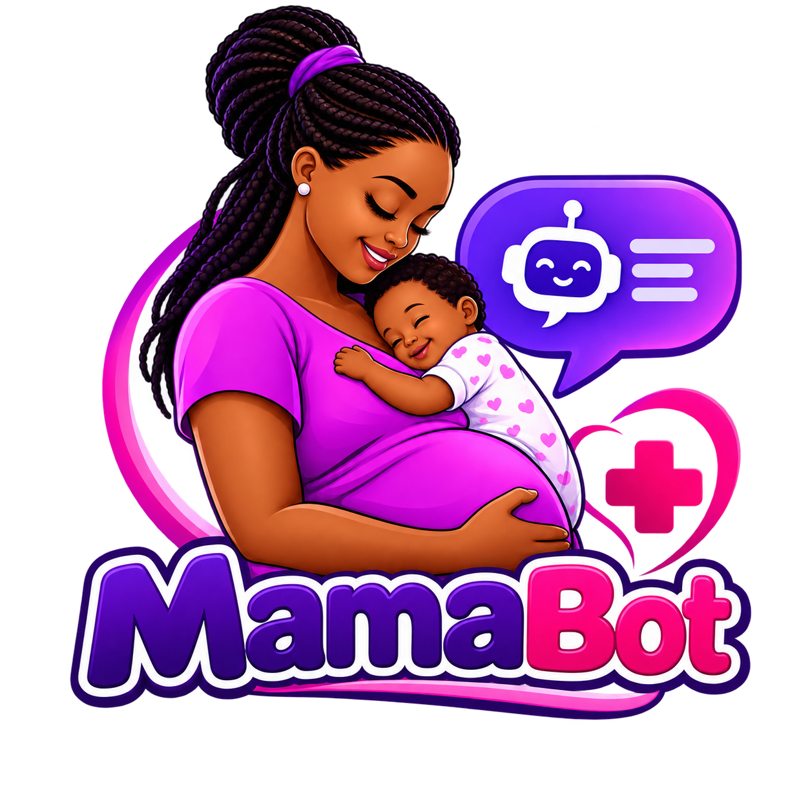

<div align="center">
  
  <h1>MamaBot</h1>
  <p>A maternal-health companion built for pregnancy guidance in English, ChiShona, and isiNdebele.</p>
  <p>
    <a href="https://github.com/PraiseTechzw/mama-mobile/actions/workflows/ci.yml"></a>
    
    
    
    
  </p>
</div>

MamaBot is an Expo and React Native prototype for pregnancy information, reminders, and maternal-health support. It is designed to work offline for core guidance, with optional online chat classification and optional WhatsApp/SMS channels.

> **Important:** MamaBot is not a medical device or a substitute for a doctor, midwife, or emergency service. Its content and translations are a prototype and have not been clinically or linguistically approved. If you have an urgent concern, contact a health professional or go to a health facility; do not wait for an in-app reply.

## What it includes

- **Three app languages:** English, ChiShona, and isiNdebele.
- **Pregnancy dashboard and information:** pregnancy progress, trimester guidance, and maternal-health information.
- **Local chat:** offline phrase matching and a fixed response catalog; it does not generate medical advice.
- **Optional online chat:** a Flask service can use OpenRouter to classify a non-urgent question and select a response from the same fixed catalog. The model does not write the answer.
- **Reminders:** create and manage reminders with on-device notifications.
- **Facility discovery:** find health facilities by search; location access is optional and used to sort nearby results.
- **Optional messaging channels:** a backend can handle inbound Twilio SMS and WhatsApp messages.

## Visuals

The images below are project illustrations, not screenshots of the running interface. App screenshots and a short screen recording will be added here when reviewed captures are available.

<div align="center">
  
  
</div>

## Getting started

### Requirements

- [Bun](https://bun.sh/) (the repository includes `bun.lock`)
- A compatible Android or iOS development environment, or an [EAS](https://docs.expo.dev/eas/) development build
- Python 3.12 or newer only if you plan to run the optional backend

### Install and run the mobile app

```sh
bun install
cp .env.example .env
bun run start
```

Open the project in a simulator or a compatible development build. The app uses native Expo modules, so Expo Go may not provide every module used by this project.

For a local native Android build (Android SDK required):

```sh
bun run android
```

For an EAS development build:

```sh
bunx eas-cli build --profile development --platform android
# or
bunx eas-cli build --profile development --platform ios
```

Android builds use a Firebase client configuration referenced from `app.json`. Obtain the correct `google-services.json` for your own Firebase project and keep it out of Git; it is intentionally ignored. Do not use or upload another project's Firebase credentials.

### Optional app configuration

The root `.env.example` documents the supported public app settings:

| Variable | Purpose |
| --- | --- |
| `EXPO_PUBLIC_MAMABOT_API_URL` | Optional HTTPS origin override for the Flask backend. Defaults to `https://mama-backend-fg8v.onrender.com`; leave unset to use that default. |
| `EXPO_PUBLIC_MAMABOT_WHATSAPP_NUMBER` | Optional public WhatsApp contact number in international digits, without `+`. |
| `EXPO_PUBLIC_MAMABOT_SMS_NUMBER` | Optional public SMS contact number in international digits, without `+`. |

`EXPO_PUBLIC_*` values are embedded in the app bundle and are **not secrets**. Never put API keys, Twilio credentials, or database passwords in them. Restart the development server and rebuild the app after changing public build-time configuration.

## Optional backend

The Flask backend supports the optional online chat endpoint and Twilio messaging webhooks. Its setup, environment variables, privacy details, local tests, and Render deployment instructions are documented in the [backend README](backend/README.md).

Before enabling online chat with real users, review the backend README's provider and data-handling disclosures. The current online flow sends the question and limited context to the backend and OpenRouter for classification. Do not include names or contact details in chat, and obtain appropriate consent before real-user testing.

## Development checks

From the repository root:

```sh
bun run lint
bun run typecheck
python -m unittest discover -s backend/tests
```

The GitHub Actions workflow runs the mobile lint/type checks and backend unit tests for pushes and pull requests to `main`.

## Project documentation

- [Contributing](CONTRIBUTING.md) — development workflow and pull-request checklist
- [Support](SUPPORT.md) — troubleshooting and where to ask for help
- [Security](SECURITY.md) — reporting a security issue safely
- [Backend setup and deployment](backend/README.md)
- [License](LICENSE)

## Health and privacy notice

Profile details, chat history, and reminders are stored on the device. When optional online chat is enabled, the current question, selected language, pregnancy week, and up to six recent chat messages may be sent to the configured backend and OpenRouter for classification; the backend does not retain chat messages. Online providers may process or retain submitted information under their own terms. Do not enter identifying or sensitive health information. Review the backend documentation and provider terms before enabling online use.

This prototype has not been validated for clinical use. A qualified maternal-health professional and fluent ChiShona and isiNdebele reviewers should review the response catalog before participant testing or real-world use. Obtain appropriate ethics approval and informed consent for any research or field testing.
